<div align="center">

# starwave

**GitHub Trending 告诉你哪些仓库已经火了。<br>starwave 告诉你哪些浪潮正在形成。**

[](https://github.com/Chaoqi31/starwave/actions/workflows/ci.yml)
[](https://github.com/Chaoqi31/starwave/actions/workflows/daily.yml)
[](package.json)
[](package.json)
[](LICENSE)

[English](README.md) · 简体中文 · [在线看今日浪潮](https://chaoqi31.github.io/starwave/) · [今日 JSON](https://chaoqi31.github.io/starwave/latest.json)



</div>

所谓浪潮，是一批新仓库在同一时间开始用同一个词。它可能围绕上周刚发布的模型，可能是大家都在写插件的某个 harness，也可能是一种突然流行的 demo 形式。starwave 读取 GitHub 上最近 14 天新建的全部仓库，找出和前 60 天相比用量突增的词，再把仓库按这些词聚成组。每组按每天新增 star 排序，由同一模板复制出来的仓库簇单独列出。

```bash
npx github:Chaoqi31/starwave
```

需要 Node 20 以上和一个 GitHub token。已登录的 `gh` 命令行可以直接用，设置 `GITHUB_TOKEN` 也行。

## 2026-09-30 这一天它发现了什么

以下数字来自当天 12:53 UTC 的抓取，也就是测试用的那份数据。顶部的图和下面的表每天更新。

- **jev：15 天 249 个仓库、14.5 万 star。** TypeSafe AI 在 9 月 15 日发布 Jev 决策模型。starwave 把 40 个词（`laya`、`typesafe`、`system-one`、`decision-model` 等）合并成这一个浪潮，这是任何单个关键词搜索都拼不出来的。单日最高是 9 月 21 日，新增 24,568 个 star。现在正在降温：这 14 天里平均每天新增 1.03 万，最近 3 天每天 5,100。
- **opus：21 个仓库，都是用 Claude Opus 5.5 做出来的东西，其中 13 个是写代码渲染的视频。** 最早的一个才 8 天，最近 3 天每天新增 1,100 个 star，而当天 GitHub Trending 的日榜和周榜上一个都没有。
- **有两个仓库簇疑似协同。** `apimart` 的 173 个仓库全部提到同一家 API 中转商，其中 146 个创建于 9 月 24 日。抓取 4 小时后，其中 105 个已经返回 404。`auto-raid-complete-script` 浪潮的 44 个仓库全是 Roblox 脚本注入器，全部创建于 9 月 18 日，最近 14 天的 star 有 98% 落在 9 月 27 日这一天。starwave 把它们放进"疑似协同"（Looks coordinated），不参与排名。

## 为什么不直接看 GitHub Trending？

| | GitHub Trending | starwave |
|---|---|---|
| 排的是什么 | 单个仓库 | 共享同一个突增词的一组新仓库 |
| 看哪些仓库 | 不限年龄 | 最近 14 天新建的 |
| 一次发布带出 249 个周边仓库 | 各自单列，前提是能挤进前 25 名 | 一个浪潮，列出每个仓库 |
| 几乎一模一样的仓库簇 | 没有这类视图 | 单独列出，每个标记都写明依据 |
| 势头 | 今日、本周或本月的 star | 最近 3 天的日均 star，外加 14 天走势图 |
| 输出 | 网页 | 终端表格、Markdown、JSON，以及 agent skill |

## 今日浪潮

GitHub Action 每天 06:17 UTC（北京时间 14:17）重写这张表。往日数据在 [`data/`](data)。

<!-- starwave:start -->
_recent 3,080 repos  2026-11-09..2026-11-23  stars>=40 · baseline 4,204 repos  2026-09-10..2026-11-08  stars>=150 · generated 2026-11-23 18:15 UTC_

| # | wave | repos | owners | stars | vel/d | 3d/d | last 14 days | first seen | anchor |
|--:|---|--:|--:|--:|--:|--:|---|---|---|
| 1 | **riemann** (+alp) | 6 | 6 | 1.7k | 536/d | 475/d | ▂▁▁▁▁▁▁▁▁▁▁█▅▄ | 2026-11-09 | [leanprover-community/riemann-hypothesis](https://github.com/leanprover-community/riemann-hypothesis) |
| 2 | **force** | 5 | 5 | 1.1k | 272/d | 152/d | ▁▁▁▁▁▁▃▅▅▂▃▂█▂ | 2026-11-14 | [34306/ForceDuoApp](https://github.com/34306/ForceDuoApp) |
| 3 | **fable** | 8 | 8 | 1.9k | 166/d | 57/d | ▁▄█▅▃▃▃▄▇▃▃▂▂▂ | 2026-11-09 | [fengyiqicoder/awesome-fable-5.2](https://github.com/fengyiqicoder/awesome-fable-5.2) |
| 4 | **streamlined** | 7 | 7 | 953 | 149/d | 54/d | ▁▁▁▁▁▁▁▁█▁▄▃▁▁ | 2026-11-15 | [Cllayver/fl-studio-installer](https://github.com/Cllayver/fl-studio-installer) |
| 5 | **changer** | 6 | 6 | 1.2k | 125/d | 102/d | ▁▁▁▁▁▁▁▁█▁▁▁▃▂ | 2026-11-10 | [D1ngtalk/iap2loc](https://github.com/D1ngtalk/iap2loc) |
| 6 | **address** | 6 | 6 | 694 | 89/d | 12/d | ▁▁▁▁▆█▁█▇▁▃▁▁▂ | 2026-11-12 | [zacharyrogue/Crypto-Whale-Tracker](https://github.com/zacharyrogue/Crypto-Whale-Tracker) |
| 7 | **hero** | 6 | 6 | 753 | 87/d | 2/d | ▂▁▁▁▁▁▁▁█▁▁▁▁▁ | 2026-11-09 | [Veeru7411/dota-2-fps-booster](https://github.com/Veeru7411/dota-2-fps-booster) |

**Looks coordinated**

| # | wave | repos | owners | stars | vel/d | 3d/d | last 14 days | first seen | anchor | flags |
|--:|---|--:|--:|--:|--:|--:|---|---|---|---|
| 1 | **software-engineering** (+windows-app, utility, scripts, setup, crack, 7 more) | 155 | 155 | 50.4k | 24.1k/d | 15.9k/d | ▁▁▁▁▁▁▁▁▁▁▁▁█▂ | 2026-11-10 | [icitycode/capcut-for-windows](https://github.com/icitycode/capcut-for-windows) | near-duplicate, same-day, flat-stars |
| 2 | **hot-reloadable** (+low-overhead, prebuilt, reloadable, configuration, overhead, 64 more) | 108 | 86 | 18.2k | 18.2k/d | 0/d | ▁▁▁▁▁▁▁▁▁▁▁▁▁▁ | 2026-11-22 | [TalhaKang/resident-evil-4-cheat-trainer](https://github.com/TalhaKang/resident-evil-4-cheat-trainer) | near-duplicate, same-day, flat-stars |
| 3 | **ai--manus** (+gemeni, manus, typescript-sdk, general-purpose, solidjs, 22 more) | 366 | 300 | 59.4k | 6.0k/d | 0/d | ▁▁▁▁██▁▁▁▁▁▁▁▁ | 2026-11-13 | [topapothecarycanal/ai--manus2.0](https://github.com/topapothecarycanal/ai--manus2.0) | near-duplicate, same-day, flat-stars |
| 4 | **xtreamcode** (+ip-tv, iptv-channels, iptv-m3u8, iptv-player, iptv-player-application, 37 more) | 267 | 239 | 36.1k | 3.8k/d | 0/d | ▁▁▁▁▅█▁▁▁▁▁▁▁▁ | 2026-11-13 | [trackersnailgrip/GitHub-Copilot-app](https://github.com/trackersnailgrip/GitHub-Copilot-app) | near-duplicate, same-day, flat-stars |
| 5 | **trial-version** (+trial, windows-software, latest, shape, download, 38 more) | 268 | 268 | 27.9k | 2.3k/d | 129/d | ▁▁█▁▁▁▁▁▁▁▁▁▁▁ | 2026-11-10 | [vivitimiguel-dotcom/protonvpn-business-client](https://github.com/vivitimiguel-dotcom/protonvpn-business-client) | same-day, flat-stars |
| 6 | **aichecker** (+config-checker, gemeni-checker, gemini-config-checker, lim, lim-seo, 10 more) | 26 | 26 | 10.0k | 1.3k/d | 0/d | ▁▁▁▁▁▁█▁▁▁▁▁▁▁ | 2026-11-15 | [YellowLaborerMarket/Gemini-Config-Checker-](https://github.com/YellowLaborerMarket/Gemini-Config-Checker-) | near-duplicate, same-day, flat-stars |
| 7 | **scripting** (+blender-mcp, blender-ai, blender-automation, blender-plugin, blender-scripting, 8 more) | 10 | 10 | 6.4k | 1.0k/d | 607/d | ▁▁▁▃▆█▄▁▃▁▆▆▅▁ | 2026-11-12 | [bookwjitchieni1986/blender-ai-mcp-addon](https://github.com/bookwjitchieni1986/blender-ai-mcp-addon) | same-day |
| 8 | **trainer** (+blade, fling, hit) | 23 | 23 | 4.3k | 985/d | 439/d | ▁▁▁▁▁▁▁▁█▁▁▁▄▁ | 2026-11-15 | [vinujak/phantom-blade-zero-modifier](https://github.com/vinujak/phantom-blade-zero-modifier) | same-day, flat-stars |
| 9 | **community-driven** (+community) | 28 | 28 | 4.4k | 671/d | 118/d | ▁▁▁▁▁▁▁▁█▁▁▁▂▁ | 2026-11-11 | [Baracos99/discord-quest-helper](https://github.com/Baracos99/discord-quest-helper) | same-day, flat-stars |
| 10 | **coregold** (+vcc, usdt, applepay, finops, architectural, 9 more) | 81 | 53 | 5.8k | 637/d | 438/d | ▁▂▃▂▃▁▁▄▃▄█▇▁▅ | 2026-11-09 | [borchertnad-creator/runpod-cloud-gpu-spend-firewall-vcc](https://github.com/borchertnad-creator/runpod-cloud-gpu-spend-firewall-vcc) | near-duplicate, flat-stars |

_vel/d: each repo's stars divided by its age in days, summed. 3d/d: stars per day over the last 3 full days._

<details><summary><b>riemann</b>: 6 repos, 1.7k stars</summary>

- [leanprover-community/riemann-hypothesis](https://github.com/leanprover-community/riemann-hypothesis) 808★ Independent Comparator setup for the Lean formalization of the Riemann Hypothes…
- [CocoSgt/riemann-hypothesis-lean](https://github.com/CocoSgt/riemann-hypothesis-lean) 543★ Mirror of Levent Alpöge's Lean proof of the Riemann Hypothesis (with Claude). A…
- [mccorvie/riemann-masullo](https://github.com/mccorvie/riemann-masullo) 106★ Lean 4 formalization of A. M. Masullo, The Music of the Primes
- [professorsolderin/project-lighthouse](https://github.com/professorsolderin/project-lighthouse) 100★ Project Lighthouse — shining AI on the pages history never read: transcriptions…
- [TomasOrtega/RH](https://github.com/TomasOrtega/RH) 77★ Lean files extracted from the archive accompanying Levent Alpöge’s Riemann Hypo…

</details>

<details><summary><b>force</b>: 5 repos, 1.1k stars</summary>

- [34306/ForceDuoApp](https://github.com/34306/ForceDuoApp) 376★ Force iPhone Duo's application use latest SDK to adaptive and supports iPhone D…
- [aathreynair22-bit/wifi-password-tester](https://github.com/aathreynair22-bit/wifi-password-tester) 337★ WiFi Credential Strength Auditor: PowerShell Brute-Force Tester for Wireless Ne…
- [SUBIR33/sbft-bip39-brute-force-framework](https://github.com/SUBIR33/sbft-bip39-brute-force-framework) 153★ SBFT BIP39 Brute-Force Framework: Concurrent Multi-Provider Balance Checking wi…
- [yunusozgur944-source/delta-force-verina](https://github.com/yunusozgur944-source/delta-force-verina) 139★ Delta Force Verina: field intel and combat readouts for sharper tactical play.
- [smolderyguest/Super3DXPlus](https://github.com/smolderyguest/Super3DXPlus) 84★ An accessibility-focused native port of Wangan Midnight Maximum Tune 3DX+ for P…

</details>

<details><summary><b>fable</b>: 8 repos, 1.9k stars</summary>

- [fengyiqicoder/awesome-fable-5.2](https://github.com/fengyiqicoder/awesome-fable-5.2) 535★ Games, 3D worlds and web pages built with Claude Fable 5.2 that you can actuall…
- [realcodebear/saltline-fable-5.2](https://github.com/realcodebear/saltline-fable-5.2) 533★ 
- [viktorkav/uno-com-escada](https://github.com/viktorkav/uno-com-escada) 171★ Fiat Uno Mille EP com escada no teto, para pilotar no navegador. Três versões d…
- [MiaAI-Lab/Claude-Fable-5.2-HTML-Files](https://github.com/MiaAI-Lab/Claude-Fable-5.2-HTML-Files) 140★ Claude Fable 5.2 HTML Files — 76 visual studies with screenshots and original p…
- [andrisgauracs/bevel-os](https://github.com/andrisgauracs/bevel-os) 131★ A small Windows-95-style desktop OS for a single ESP32-S3 on a VGA monitor, wri…

</details>

<details><summary><b>streamlined</b>: 7 repos, 953 stars</summary>

- [Cllayver/fl-studio-installer](https://github.com/Cllayver/fl-studio-installer) 154★ FL Studio Installer: Streamlined Setup and Enhanced Performance
- [alkabdohagag/fxdeck-fivem-command-deck](https://github.com/alkabdohagag/fxdeck-fivem-command-deck) 154★ FxDeck FiveM Command Deck - Streamlined In-Game Command Interface for Modders
- [tahsintasnuva/voice-notes-pipeline](https://github.com/tahsintasnuva/voice-notes-pipeline) 153★ Voice Notes Pipeline: Automation Script for Streamlined Note Processing
- [Bhavya-ragala95/monster-hunter-wilds-varvana](https://github.com/Bhavya-ragala95/monster-hunter-wilds-varvana) 139★ Streamlined monster data and field intel so you hunt smarter in Monster Hunter …
- [kenzz-devv/open-webui-talora-ai-workspace](https://github.com/kenzz-devv/open-webui-talora-ai-workspace) 139★ Streamlined workspace for organizing and running AI workflows in one place.

</details>

<details><summary><b>changer</b>: 6 repos, 1.2k stars</summary>

- [D1ngtalk/iap2loc](https://github.com/D1ngtalk/iap2loc) 460★ A cross-platform iOS location changer client. 跨平台 iOS 虚拟定位客户端，通过 iAP2 协议向 iOS 设…
- [Tchikov23/cs2-cosmetic-swapper](https://github.com/Tchikov23/cs2-cosmetic-swapper) 153★ CS2 Cosmetic Swapper - Client-Side Skin Changer for Windows 10/11
- [Yunnix001/fortnite-skin-changer](https://github.com/Yunnix001/fortnite-skin-changer) 153★ Fortnite Skin Changer: Preview and Customize Rare Skins Locally
- [diom1995/skeet-cs2-cheat](https://github.com/diom1995/skeet-cs2-cheat) 153★ Skeet Cheat: Precision Internal Framework for Competitive Play
- [moamenrdakje/xeno-protocol-core](https://github.com/moamenrdakje/xeno-protocol-core) 153★ Xeno Protocol Core - Community Discord and Telegram Bot with Rich Features

</details>
<!-- starwave:end -->

## 用法

```bash
npx github:Chaoqi31/starwave                           # 最近 14 天的浪潮
npx github:Chaoqi31/starwave --show jev                # 某个浪潮的全部仓库，附 14 天 star 走势
npx github:Chaoqi31/starwave --days 7 --min-stars 100  # 更短的窗口，更高的门槛
npx github:Chaoqi31/starwave --json                    # 完整快照，给脚本和 agent 用
npx github:Chaoqi31/starwave --md                      # Markdown 表格，可以直接贴
```

第一次运行要 3 到 5 分钟，因为 GitHub 搜索 API 每分钟只允许 30 次请求。结果会在 `~/.cache/starwave` 缓存 6 小时，之后再跑是秒出。第一次执行 `npx github:` 还要下载并构建 starwave，实测网速快时 10 秒，网速慢时约 2 分钟。想长期保留 `starwave` 命令，运行 `npm install -g github:Chaoqi31/starwave`。

| 参数 | 默认值 | 含义 |
|---|---|---|
| `--days <n>` | 14 | 近期窗口的天数 |
| `--min-stars <n>` | 40 | 近期仓库的最低 star 数 |
| `--baseline-days <n>` | 60 | 近期窗口之前的基线天数 |
| `--baseline-min-stars <n>` | 150 | 基线仓库的最低 star 数 |
| `--top <n>` | 15 | 每个分区打印多少个浪潮 |
| `--show <id>` | | 列出某个浪潮的全部仓库 |
| `--json`、`--md` | | 输出 JSON 或 Markdown，而不是表格 |
| `--from <file>` | | 读取保存过的抓取结果或快照（`.json` 或 `.json.gz`），不请求 GitHub |
| `--save <file>` | | 保存原始抓取结果 |
| `--no-history` | | 跳过 star 历史（约 500 次请求） |
| `--no-cache`、`--no-color` | | 忽略缓存、纯文本输出 |

## 在 agent 里用

`skills/starwave/SKILL.md` 教 Claude Code、Codex 以及其他读取 `SKILL.md` 的 agent 运行 starwave 并总结结果。装好之后直接问："这周 GitHub 上什么在爆？"

在 Claude Code 里：

```text
/plugin marketplace add Chaoqi31/starwave
/plugin install starwave@starwave
```

用 skills 命令行，适用于任何 agent：

```bash
npx skills add Chaoqi31/starwave
```

## 原理

1. 抓取最近 14 天新建、star 不少于 40 的全部仓库，以及再往前 60 天、star 不少于 150 的仓库作为基线。搜索 API 每次查询最多返回 1,000 条，所以 starwave 按日期切片查询。
2. 把每个仓库变成一组词：名称和描述里的拉丁字母词、复合词拆出的部分（`hermes-jev-skills` 也会拆出 `jev`）、以及 topics，去掉停用词。
3. 先把模板化仓库挑出来。某个仓库的词和另一个 owner 的仓库 Jaccard 相似度达到 0.6，就算作复制品，复制品单独分组。
4. 按突增度给每个词打分：带这个词的近期仓库数，除以基线预测的数量。仓库集合重叠 40% 以上的词合并成一个浪潮。除了浪潮词以外互相毫无共同点的浪潮会被丢掉。
5. 抓取每个浪潮里每个仓库的 star 历史，每次并发 6 个。这样得到最近 3 天的日均 star 和 14 天走势，统计范围和生命周期日均完全一致。

阈值、取值理由以及锁定它们的测试都在 [DESIGN.md](DESIGN.md)（英文）。

## 不装任何东西也能拿到数据

- [chaoqi31.github.io/starwave](https://chaoqi31.github.io/starwave/) 展示今日浪潮。
- [`latest.json`](https://chaoqi31.github.io/starwave/latest.json) 是今日快照，结构见 [DESIGN.md](DESIGN.md#data-shapes-srctypests) 里的 `Snapshot`。
- [`data/YYYY-MM-DD.json.gz`](data) 每天一份快照，每份约 40 KB。

## 当库用

包导出 `detectWaves`、`renderMarkdown`、`renderTable` 和全部类型。库本身不发网络请求，你传入 `Repo[]` 数组即可，比如 `--save capture.json` 保存下来的数据。

```ts
import { readFileSync } from "node:fs";
import { detectWaves, renderMarkdown } from "starwave";

const { recentWindow, baselineWindow, recent, baseline } = JSON.parse(readFileSync("capture.json", "utf8"));
const waves = detectWaves(recent, baseline, { today: "2026-09-30" });
const snapshot = { generatedAt: new Date().toISOString(), recentWindow, baselineWindow, recentCount: recent.length, baselineCount: baseline.length, waves };
console.log(renderMarkdown(snapshot, { top: 10 }));
```

## 常见问题

**被标记的浪潮就是刷星吗？** starwave 不下这个结论。每个标记只说明测到了什么：`same-day` 是 60% 以上的仓库在同一天创建，`few-owners` 是 owner 数不到仓库数的一半，`flat-stars` 是没有任何一个仓库占到总 star 的 10%，`near-duplicate` 是这些仓库由同一个模板复制而来。用 `--show <id>` 自己看一眼那些仓库。

**为什么只看最近 14 天的仓库？** 成熟仓库 GitHub Trending 已经覆盖了。浪潮最先出现在互相借用词汇的新仓库里。

**能读中文、日文、韩文描述吗？** 暂时不能。中日韩文描述只贡献其中的拉丁字母词和 topics。不过很多中文仓库仍然能靠名称和 topics 进入浪潮。

**跑一次要花多少钱？** 只花 API 配额：用你自己的 token，大约 60 次搜索请求和 500 次 star 历史请求。

**阈值是怎么定的？** 在 2026-09-30 的一份抓取数据上调出来的，这份数据也是测试夹具。测试里点名了每个阈值必须保留或排除的仓库。

## Star 历史

[](https://star-history.com/#Chaoqi31/starwave&Date)

如果 starwave 比你的信息流更早让你看到了某个浪潮，点个 star，能帮下一个人找到它。

MIT 许可证。
