<div align="center">

# starwave

**GitHub Trending 告诉你哪些仓库已经火了。<br>starwave 告诉你哪些浪潮正在形成。**

[](https://github.com/Chaoqi31/starwave/actions/workflows/ci.yml)
[](https://github.com/Chaoqi31/starwave/actions/workflows/daily.yml)
[](package.json)
[](package.json)
[](LICENSE)

[English](README.md) · 简体中文 · [在线看今日浪潮](https://chaoqi31.github.io/starwave/) · [今日 JSON](https://chaoqi31.github.io/starwave/latest.json)



</div>

所谓浪潮，是一批新仓库在同一时间开始用同一个词。它可能围绕上周刚发布的模型，可能是大家都在写插件的某个 harness，也可能是一种突然流行的 demo 形式。starwave 读取 GitHub 上最近 14 天新建的全部仓库，找出和前 60 天相比用量突增的词，再把仓库按这些词聚成组。每组按每天新增 star 排序，由同一模板复制出来的仓库簇单独列出。

```bash
npx github:Chaoqi31/starwave
```

需要 Node 20 以上和一个 GitHub token。已登录的 `gh` 命令行可以直接用，设置 `GITHUB_TOKEN` 也行。

## 2026-09-30 这一天它发现了什么

以下数字来自当天 12:53 UTC 的抓取，也就是测试用的那份数据。顶部的图和下面的表每天更新。

- **jev：15 天 249 个仓库、14.5 万 star。** TypeSafe AI 在 9 月 15 日发布 Jev 决策模型。starwave 把 40 个词（`laya`、`typesafe`、`system-one`、`decision-model` 等）合并成这一个浪潮，这是任何单个关键词搜索都拼不出来的。单日最高是 9 月 21 日，新增 24,568 个 star。现在正在降温：这 14 天里平均每天新增 1.03 万，最近 3 天每天 5,100。
- **opus：21 个仓库，都是用 Claude Opus 5.5 做出来的东西，其中 13 个是写代码渲染的视频。** 最早的一个才 8 天，最近 3 天每天新增 1,100 个 star，而当天 GitHub Trending 的日榜和周榜上一个都没有。
- **有两个仓库簇疑似协同。** `apimart` 的 173 个仓库全部提到同一家 API 中转商，其中 146 个创建于 9 月 24 日。抓取 4 小时后，其中 105 个已经返回 404。`auto-raid-complete-script` 浪潮的 44 个仓库全是 Roblox 脚本注入器，全部创建于 9 月 18 日，最近 14 天的 star 有 98% 落在 9 月 27 日这一天。starwave 把它们放进"疑似协同"（Looks coordinated），不参与排名。

## 为什么不直接看 GitHub Trending？

| | GitHub Trending | starwave |
|---|---|---|
| 排的是什么 | 单个仓库 | 共享同一个突增词的一组新仓库 |
| 看哪些仓库 | 不限年龄 | 最近 14 天新建的 |
| 一次发布带出 249 个周边仓库 | 各自单列，前提是能挤进前 25 名 | 一个浪潮，列出每个仓库 |
| 几乎一模一样的仓库簇 | 没有这类视图 | 单独列出，每个标记都写明依据 |
| 势头 | 今日、本周或本月的 star | 最近 3 天的日均 star，外加 14 天走势图 |
| 输出 | 网页 | 终端表格、Markdown、JSON，以及 agent skill |

## 今日浪潮

GitHub Action 每天 06:17 UTC（北京时间 14:17）重写这张表。往日数据在 [`data/`](data)。

<!-- starwave:start -->
_recent 2,359 repos  2026-10-24..2026-11-07  stars>=40 · baseline 3,622 repos  2026-08-25..2026-10-23  stars>=150 · generated 2026-11-07 13:06 UTC_

| # | wave | repos | owners | stars | vel/d | 3d/d | last 14 days | first seen | anchor |
|--:|---|--:|--:|--:|--:|--:|---|---|---|
| 1 | **pixel-art** | 13 | 13 | 7.9k | 938/d | 613/d | ▁▁▁▁▁▂▃▇█▅▄▄▃▃ | 2026-10-24 | [patch-gg/pixelfx](https://github.com/patch-gg/pixelfx) |
| 2 | **lag** (+ping) | 7 | 7 | 1.7k | 739/d | 340/d | ▁▁▁▁▁▁▅▁▁▁▅█▁▆ | 2026-10-30 | [PulverizeLink/roblox-performance-tool](https://github.com/PulverizeLink/roblox-performance-tool) |
| 3 | **blockchain** (+bnb) | 8 | 8 | 1.2k | 379/d | 245/d | ▁▁▁▁▁▁▁▄▁▄▅▆█▄ | 2026-10-30 | [PatchBuilderAmplify/stolen-crypto-tracer](https://github.com/PatchBuilderAmplify/stolen-crypto-tracer) |
| 4 | **sniper** (+bsc) | 5 | 5 | 865 | 357/d | 186/d | ▁▂▂▁▂▂▂▁▁▁▁▁█▃ | 2026-10-25 | [Nebularotunnel/Token-Sniper](https://github.com/Nebularotunnel/Token-Sniper) |
| 5 | **forensics** | 5 | 5 | 848 | 341/d | 148/d | ▁▁▁▁▁▁▃▂▁▂▇▆▄█ | 2026-10-25 | [1337isnot1337/DOPPLERGEIST](https://github.com/1337isnot1337/DOPPLERGEIST) |
| 6 | **eglantine** | 5 | 5 | 936 | 336/d | 267/d | ▁▁▁▁▁▁▁▁▁▂▂▄▆█ | 2026-11-01 | [riyadhHDA/wichforks](https://github.com/riyadhHDA/wichforks) |
| 7 | **regularly** | 7 | 7 | 1.5k | 321/d | 162/d | ▁▁▁▃▁▁▅▅▅▁▁█▁▁ | 2026-10-27 | [TinsmithConsole60/Roblox-Account-Manager-Multi-Account-Tool-2026](https://github.com/TinsmithConsole60/Roblox-Account-Manager-Multi-Account-Tool-2026) |
| 8 | **leveling** | 5 | 5 | 807 | 252/d | 222/d | ▁▁▁▁▁▁▁▁▁▁▂█▁▁ | 2026-11-01 | [protonversestudio/wow-forever-builds-kindred](https://github.com/protonversestudio/wow-forever-builds-kindred) |
| 9 | **portrait** (+pose-reference) | 8 | 8 | 797 | 171/d | 63/d | ▁▁▂▂▁▃▅▄▆█▅▃▃▅ | 2026-10-26 | [yt1988/who-are-you](https://github.com/yt1988/who-are-you) |
| 10 | **six** | 6 | 6 | 1.1k | 164/d | 95/d | ▁▁▁▁▄▃▂▃▅▆█▅▃▄ | 2026-10-25 | [artemnovitckii/claude-animation-skills](https://github.com/artemnovitckii/claude-animation-skills) |

**Looks coordinated**

| # | wave | repos | owners | stars | vel/d | 3d/d | last 14 days | first seen | anchor | flags |
|--:|---|--:|--:|--:|--:|--:|---|---|---|---|
| 1 | **configured** (+pre-configured, utility, software-engineering, windows-app, ensuring, 46 more) | 166 | 166 | 24.5k | 22.4k/d | 8.1k/d | ▁▁▁▁▁▁▁▁▁▁▁▁▁█ | 2026-10-27 | [chordexpertflourish/autocad](https://github.com/chordexpertflourish/autocad) | near-duplicate, same-day, flat-stars |
| 2 | **activator** (+kms, windows-10, activation, scala, office365, 22 more) | 137 | 137 | 6.3k | 6.0k/d | 73/d | ▁▁▁▁▁▁█▁▁▁▁▁▁▅ | 2026-10-29 | [Layerriclient/microsoft-365](https://github.com/Layerriclient/microsoft-365) | near-duplicate, same-day, flat-stars |
| 3 | **gemeni** (+general-purpose, manus, purpose, typescript-sdk, function-calling, 19 more) | 66 | 59 | 5.3k | 5.3k/d | 258/d | ▁▁▁▁▁▁▁▁▁▁▁▁▁█ | 2026-11-06 | [quyetcao/ai-manus](https://github.com/quyetcao/ai-manus) | near-duplicate, same-day, flat-stars |
| 4 | **ai-image-generation** (+apimart, gpt-image) | 14 | 2 | 1.8k | 697/d | 444/d | ▁▁▁▁▁▂▁▁▁▂▁▁█▂ | 2026-10-29 | [wquguru/shisei](https://github.com/wquguru/shisei) | same-day, few-owners |
| 5 | **rpocket** (+desert) | 30 | 30 | 1.2k | 601/d | 400/d | ▁▁▁▁▁▁▁▁▁▁▁▁█▁ | 2026-11-05 | [RiventronLucky53535/crypto-rpocket-accumulation-scanner](https://github.com/RiventronLucky53535/crypto-rpocket-accumulation-scanner) | same-day, flat-stars |
| 6 | **resocket** | 16 | 16 | 640 | 320/d | 213/d | ▁▁▁▁▁▁▁▁▁▁▁▁█▁ | 2026-11-05 | [AstraLunarvenom33479/BloodStrike-region-limit-resocket](https://github.com/AstraLunarvenom33479/BloodStrike-region-limit-resocket) | same-day |
| 7 | **coregold** (+vcc, usdt, visa, mastercard) | 42 | 37 | 2.4k | 283/d | 309/d | ▁▁▁▁▃▄▅▃▇▁▅█▇▁ | 2026-10-28 | [gutrfgtd-cyber/CoreGold---Direct-Issue-Global-Virtual-Credit-Card-Infrastructure-Management-Console](https://github.com/gutrfgtd-cyber/CoreGold---Direct-Issue-Global-Virtual-Credit-Card-Infrastructure-Management-Console) | flat-stars |
| 8 | **resp** | 11 | 11 | 441 | 221/d | 147/d | ▁▁▁▁▁▁▁▁▁▁▁▁█▁ | 2026-11-05 | [ViaBecrest/Eden-Switch-Emulator-resp](https://github.com/ViaBecrest/Eden-Switch-Emulator-resp) | same-day |
| 9 | **aion** (+aion-2, mmorpg, aion2, dps-meter, dps, 6 more) | 15 | 15 | 863 | 62/d | 2/d | ▁█▁▁▁▁▁▁▁▁▁▁▁▁ | 2026-10-24 | [ORICHO08/aion2-combat-overlay](https://github.com/ORICHO08/aion2-combat-overlay) | same-day |

_vel/d: each repo's stars divided by its age in days, summed. 3d/d: stars per day over the last 3 full days._

<details><summary><b>pixel-art</b>: 13 repos, 7.9k stars</summary>

- [patch-gg/pixelfx](https://github.com/patch-gg/pixelfx) 5.7k★ 244 pixel art effects, every one a small piece of code. Plus a Claude Code skil…
- [yalongwastaken/git-koi](https://github.com/yalongwastaken/git-koi) 618★ Draw a pixel-art koi from a GitHub account's public activity, as a looping GIF …
- [Lanqiao-Luca/ai-video-marker](https://github.com/Lanqiao-Luca/ai-video-marker) 385★ 🎬 AI 视频制作与 AIGC 创作工作流（AI Video Creation Workflow）｜用 AI 制作视频、像素动画与漫画短片｜分镜、素材、配乐…
- [sloemo01/diorama](https://github.com/sloemo01/diorama) 346★ Playbook and Three.js code kit for detailed dioramas: classic pixel art, stroke…
- [SparrowPortray/horizon-free-capes](https://github.com/SparrowPortray/horizon-free-capes) 231★ Every cape, wing, hat, pet and emote in Drip is free: 24 capes, your own PNG or…

</details>

<details><summary><b>lag</b>: 7 repos, 1.7k stars</summary>

- [PulverizeLink/roblox-performance-tool](https://github.com/PulverizeLink/roblox-performance-tool) 426★ Lightweight performance utility for Roblox on Windows. Boosts FPS, fixes stutte…
- [StormSkinkGrip/game-ping-multipath-router](https://github.com/StormSkinkGrip/game-ping-multipath-router) 325★ Shortcut races your normal route against faster ones to the game server, sends …
- [Badgenyamultiplexer/pc-game-fps-doctor](https://github.com/Badgenyamultiplexer/pc-game-fps-doctor) 305★ One button: why the game stutters, why it lags and why it won't start. Pitstop …
- [QuantumBladesmith/FPS-Optimizer-Universal-Game-Performance-Booster-2026](https://github.com/QuantumBladesmith/FPS-Optimizer-Universal-Game-Performance-Booster-2026) 302★ Powerful FPS Optimizer for all games. Increase frame rate, reduce lag and stutt…
- [SkinkSmelter6/valorant-fps-lag-fixer](https://github.com/SkinkSmelter6/valorant-fps-lag-fixer) 272★ VALORANT stutters, lags or won't start? Tick reads the Vanguard code, measures …

</details>

<details><summary><b>blockchain</b>: 8 repos, 1.2k stars</summary>

- [PatchBuilderAmplify/stolen-crypto-tracer](https://github.com/PatchBuilderAmplify/stolen-crypto-tracer) 387★ Paste a wallet or a transaction hash and follow stolen crypto to the exchange t…
- [Danuse84/Exodus-Fake-Balance](https://github.com/Danuse84/Exodus-Fake-Balance) 255★ Wallet UI simulation tool for BTC, ETH, SOL, XRP, and 200+ assets. Customize di…
- [Signcluengine/onchain-money-trail-analyzer](https://github.com/Signcluengine/onchain-money-trail-analyzer) 166★ Follow stolen crypto hop by hop across Bitcoin, Ethereum, TRON, BNB Chain and S…
- [zeemscript/block-roll](https://github.com/zeemscript/block-roll) 164★ Non-custodial, encrypted file storage & sharing platform with Stellar payments …
- [git-wallet/gitwallet](https://github.com/git-wallet/gitwallet) 61★ GitWallet — non-custodial multi-chain crypto wallet for Android. 14 blockchains…

</details>

<details><summary><b>sniper</b>: 5 repos, 865 stars</summary>

- [Nebularotunnel/Token-Sniper](https://github.com/Nebularotunnel/Token-Sniper) 391★ Advanced desktop analyzer for DEX activity. Monitors new liquidity pair creatio…
- [jacke-pp/ai-wallet-binance](https://github.com/jacke-pp/ai-wallet-binance) 308★ 让任何 AI 用你自己的币安 AI 钱包交易：秒买秒卖、狙击 Agent 专属发射台（Four、Flap、GANG）、AI 专属 Mint、本机交易页面。币安…
- [Stratumgreawning7/MemeCoin-Sniper-Bot](https://github.com/Stratumgreawning7/MemeCoin-Sniper-Bot) 58★ Crypto Meme Coin Sniper Bot for Automated Trading, New Token Sniping, Meme Toke…
- [hamnurger0501/binance-agentic-sniper](https://github.com/hamnurger0501/binance-agentic-sniper) 57★ BSC launchpad sniper (Gang V3 / Fair / CA / Flap Agent-ID) using Binance Agenti…
- [Beingfluresurrect/Solana-token-sniper](https://github.com/Beingfluresurrect/Solana-token-sniper) 51★ Solana token sniper for Raydium V4 and Pump.fun. Bypass mempool with Jito MEV b…

</details>

<details><summary><b>forensics</b>: 5 repos, 848 stars</summary>

- [1337isnot1337/DOPPLERGEIST](https://github.com/1337isnot1337/DOPPLERGEIST) 406★ Python tool for aircraft Doppler audio geolocation using historical ADS-B fligh…
- [arnold117/iOS-NOIR](https://github.com/arnold117/iOS-NOIR) 224★ No-jailbreak iOS privacy, entitlement, sandbox & telemetry forensic auditor (in…
- [phishdestroy/TgWitness](https://github.com/phishdestroy/TgWitness) 109★ Telegram chat exporter and OSINT evidence workspace. Preserve observed edits an…
- [acnekot/frauddb](https://github.com/acnekot/frauddb) 59★ 
- [ycc77cn/skills](https://github.com/ycc77cn/skills) 50★ 杨CC 开源 AI Agent 技能合集 \| Divination, Software Development, Digital Forensics

</details>
<!-- starwave:end -->

## 用法

```bash
npx github:Chaoqi31/starwave                           # 最近 14 天的浪潮
npx github:Chaoqi31/starwave --show jev                # 某个浪潮的全部仓库，附 14 天 star 走势
npx github:Chaoqi31/starwave --days 7 --min-stars 100  # 更短的窗口，更高的门槛
npx github:Chaoqi31/starwave --json                    # 完整快照，给脚本和 agent 用
npx github:Chaoqi31/starwave --md                      # Markdown 表格，可以直接贴
```

第一次运行要 3 到 5 分钟，因为 GitHub 搜索 API 每分钟只允许 30 次请求。结果会在 `~/.cache/starwave` 缓存 6 小时，之后再跑是秒出。第一次执行 `npx github:` 还要下载并构建 starwave，实测网速快时 10 秒，网速慢时约 2 分钟。想长期保留 `starwave` 命令，运行 `npm install -g github:Chaoqi31/starwave`。

| 参数 | 默认值 | 含义 |
|---|---|---|
| `--days <n>` | 14 | 近期窗口的天数 |
| `--min-stars <n>` | 40 | 近期仓库的最低 star 数 |
| `--baseline-days <n>` | 60 | 近期窗口之前的基线天数 |
| `--baseline-min-stars <n>` | 150 | 基线仓库的最低 star 数 |
| `--top <n>` | 15 | 每个分区打印多少个浪潮 |
| `--show <id>` | | 列出某个浪潮的全部仓库 |
| `--json`、`--md` | | 输出 JSON 或 Markdown，而不是表格 |
| `--from <file>` | | 读取保存过的抓取结果或快照（`.json` 或 `.json.gz`），不请求 GitHub |
| `--save <file>` | | 保存原始抓取结果 |
| `--no-history` | | 跳过 star 历史（约 500 次请求） |
| `--no-cache`、`--no-color` | | 忽略缓存、纯文本输出 |

## 在 agent 里用

`skills/starwave/SKILL.md` 教 Claude Code、Codex 以及其他读取 `SKILL.md` 的 agent 运行 starwave 并总结结果。装好之后直接问："这周 GitHub 上什么在爆？"

在 Claude Code 里：

```text
/plugin marketplace add Chaoqi31/starwave
/plugin install starwave@starwave
```

用 skills 命令行，适用于任何 agent：

```bash
npx skills add Chaoqi31/starwave
```

## 原理

1. 抓取最近 14 天新建、star 不少于 40 的全部仓库，以及再往前 60 天、star 不少于 150 的仓库作为基线。搜索 API 每次查询最多返回 1,000 条，所以 starwave 按日期切片查询。
2. 把每个仓库变成一组词：名称和描述里的拉丁字母词、复合词拆出的部分（`hermes-jev-skills` 也会拆出 `jev`）、以及 topics，去掉停用词。
3. 先把模板化仓库挑出来。某个仓库的词和另一个 owner 的仓库 Jaccard 相似度达到 0.6，就算作复制品，复制品单独分组。
4. 按突增度给每个词打分：带这个词的近期仓库数，除以基线预测的数量。仓库集合重叠 40% 以上的词合并成一个浪潮。除了浪潮词以外互相毫无共同点的浪潮会被丢掉。
5. 抓取每个浪潮里每个仓库的 star 历史，每次并发 6 个。这样得到最近 3 天的日均 star 和 14 天走势，统计范围和生命周期日均完全一致。

阈值、取值理由以及锁定它们的测试都在 [DESIGN.md](DESIGN.md)（英文）。

## 不装任何东西也能拿到数据

- [chaoqi31.github.io/starwave](https://chaoqi31.github.io/starwave/) 展示今日浪潮。
- [`latest.json`](https://chaoqi31.github.io/starwave/latest.json) 是今日快照，结构见 [DESIGN.md](DESIGN.md#data-shapes-srctypests) 里的 `Snapshot`。
- [`data/YYYY-MM-DD.json.gz`](data) 每天一份快照，每份约 40 KB。

## 当库用

包导出 `detectWaves`、`renderMarkdown`、`renderTable` 和全部类型。库本身不发网络请求，你传入 `Repo[]` 数组即可，比如 `--save capture.json` 保存下来的数据。

```ts
import { readFileSync } from "node:fs";
import { detectWaves, renderMarkdown } from "starwave";

const { recentWindow, baselineWindow, recent, baseline } = JSON.parse(readFileSync("capture.json", "utf8"));
const waves = detectWaves(recent, baseline, { today: "2026-09-30" });
const snapshot = { generatedAt: new Date().toISOString(), recentWindow, baselineWindow, recentCount: recent.length, baselineCount: baseline.length, waves };
console.log(renderMarkdown(snapshot, { top: 10 }));
```

## 常见问题

**被标记的浪潮就是刷星吗？** starwave 不下这个结论。每个标记只说明测到了什么：`same-day` 是 60% 以上的仓库在同一天创建，`few-owners` 是 owner 数不到仓库数的一半，`flat-stars` 是没有任何一个仓库占到总 star 的 10%，`near-duplicate` 是这些仓库由同一个模板复制而来。用 `--show <id>` 自己看一眼那些仓库。

**为什么只看最近 14 天的仓库？** 成熟仓库 GitHub Trending 已经覆盖了。浪潮最先出现在互相借用词汇的新仓库里。

**能读中文、日文、韩文描述吗？** 暂时不能。中日韩文描述只贡献其中的拉丁字母词和 topics。不过很多中文仓库仍然能靠名称和 topics 进入浪潮。

**跑一次要花多少钱？** 只花 API 配额：用你自己的 token，大约 60 次搜索请求和 500 次 star 历史请求。

**阈值是怎么定的？** 在 2026-09-30 的一份抓取数据上调出来的，这份数据也是测试夹具。测试里点名了每个阈值必须保留或排除的仓库。

## Star 历史

[](https://star-history.com/#Chaoqi31/starwave&Date)

如果 starwave 比你的信息流更早让你看到了某个浪潮，点个 star，能帮下一个人找到它。

MIT 许可证。
